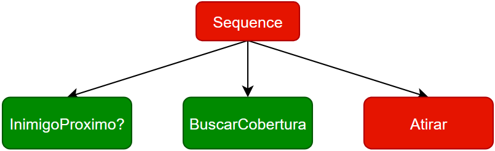
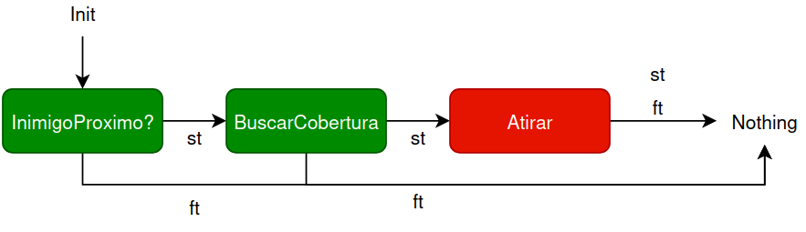

# Embedded Behavior Tree

A **Behavior Tree engine for embedded systems** in plain, RTOS-agnostic C. You design the tree visually (Groot2 or BTree Studio), export XML, and a Python pipeline compiles it into a **Minimum Behavior Graph**: a flat `const` array with no control nodes, no stack and no recursion, executed with one O(1) transition per tick.

It is the practical implementation of the undergraduate thesis *"Behavior Trees: An Approach for Embedded Systems"* (Institute of Computing — UFAL, 2025). The thesis is written in Portuguese (*"Árvores de comportamento: uma abordagem para sistemas embarcados"*); the full PDF is in [`docs/Behavior_Tree.pdf`](docs/Behavior_Tree.pdf).

The repo also includes **[BTree Studio](#btree-studio)**, a visual editor and live debugger based on Groot2 but built for embedded targets.

> **AI disclosure:** only BTree Studio (`btree_studio/`) was developed with the help of AI (Claude). The C library, the code generation pipeline and the examples were not.

**Contents:** [Idea](#the-idea-the-minimum-behavior-graph) · [Formal background](#formal-background) · [Layout](#repository-layout) · [Library](#core-library-btree-lib) · [Pipeline](#code-generation-pipeline-scripts) · [Integration](#integrating-into-your-firmware) · [Reactive](#reactive-vs-non-reactive-execution) · [BTree Studio](#btree-studio) · [Validation](#examples-and-validation) · [Memory](#memory-footprint) · [Roadmap](#roadmap) · [License](#license)

---

## The idea: the Minimum Behavior Graph

A conventional Behavior Tree is walked recursively from the root on every tick, revisiting `Sequence`/`Fallback` nodes each time a child returns. On a microcontroller that costs stack, repeated traversal of nodes whose state didn't change, and RAM/flash per node.

Here, the logic of `Sequence`/`Fallback` is **resolved once, at build time**. What ships to the MCU is not the tree but the *result* of flattening it: every leaf/decorator already knows where to go on success (`st_index`) and on failure (`ft_index`). Control nodes disappear from the final array.

| Conventional tick (repeated control-node evaluation) | Minimum Behavior Graph (one node per tick) |
|---|---|
|  |  |

Each node ([`btree_definition.h`](btree-lib/btree/include/btree_definition.h)) holds only its type, the two next indices and a small union payload: a function pointer or a sleep timeout for leaves; `times`, a counter slot and a branch limit for decorators. Running the tree is just:

```
run node[i]
success -> i = node[i].st_index
fail    -> i = node[i].ft_index
running -> stay here, return STAND_BY
```

This is `btree_process_node()` in [`btree_process.c`](btree-lib/btree/src/btree_process.c). Per-node state (`Idle`/`Success`/`Fail`/`ReExecute`) is packed into **2 bits** in a shared `uint32_t` buffer. A 16-node tree uses 4 bytes of RAM for state, while the array itself lives in flash.

More figures from the thesis (graphs vs. DAGs, the sibling-reference intermediate structure, step-by-step executions) are in [`docs/images/`](docs/images).

## Formal background

The thesis builds the Minimum Behavior Graph from practice and from the execution traces of the tree, without a formal proof that a behavior tree can always be rewritten as an equivalent graph of decisions. That formal treatment exists in:

> O. Biggar, M. Zamani, I. Shames. *On modularity in reactive control architectures, with an application to formal verification.* ACM Transactions on Cyber-Physical Systems. [arXiv:2008.12515](https://arxiv.org/abs/2008.12515)

The paper models behavior trees as *decision structures*, graphs where each action has a success edge and a failure edge (the same idea as `st_index`/`ft_index` here), and proves how their modules decompose. It is **not cited in the thesis or PDF** because I only became aware of it after the thesis was submitted; it is referenced here because it is the right place to look for the theory and its proof.

## Repository layout

```
btree-lib/btree/        the engine: include/ + src/ (definition, process, manager, common)
Scripts/                XML → C generator (runs on your PC) + tree-examples/ (Groot2 .btproj/.xml)
btree_studio/           BTree Studio: visual editor + live debugger (made with AI)
examples/ble-wifi/      ESP-IDF (ESP32) project using a generated tree
BehaviorTree.CPP/       the same trees in BehaviorTree.CPP, used to validate execution order
docs/images/            thesis figures
```

## Core library (`btree-lib`)

**Portable C, one platform hook.** The only thing you implement is the delay used by `Sleep` nodes: `btree_common_action_timeout()` in [`btree_common.c`](btree-lib/btree/src/btree_common.c). It already splits `timeout_ms` into h/min/s/ms; add your RTOS/HAL delay at the `// Input here delay funcion` line.

**Node types.** Every type has a `REACTIVE_*` twin (re-evaluated on each tick, see [Reactive vs non-reactive](#reactive-vs-non-reactive-execution)) and a `BTREE_DEFINITION_CREATE_NODE_*` macro, which the generator emits for you. Sequences and fallbacks are not node types: they are compiled away into the `st`/`ft` edges.

*Leaves* (call your code or wait):

- **`CONDITION`**: calls a user function that checks something and returns `SUCCESS` or `FAIL`.
- **`ACTION`**: calls a user function that does something. Besides `SUCCESS`/`FAIL` it may return `RUNNING` or `STAND_BY`; the tree then pauses on this node and calls it again on the next tick.
- **`ACTION_SLEEP`**: waits `timeout_ms` milliseconds through the platform delay hook in `btree_common_action_timeout()`, then succeeds.

*Decorators* (one child branch, change how it runs or what it returns):

- **`RETRY_UNTIL_SUCCESS`**: runs the branch again each time it fails, up to `times` attempts. Returns `SUCCESS` on the first success, `FAIL` when the attempts run out.
- **`REPEAT`**: runs the branch `times` times and returns the result of the last run.
- **`KEEP_RUNNING_UNTIL_SUCCESS`**: restarts the branch whenever it fails, with no limit, and only returns once it succeeds.
- **`INVERTER`**: swaps the branch result, `SUCCESS` becomes `FAIL` and vice versa.
- **`FORCE_SUCCESS`**: runs the branch and always returns `SUCCESS`.
- **`FORCE_FAIL`**: runs the branch and always returns `FAIL`.

**Statuses:** `RUNNING`, `SUCCESS`, `FAIL`, `RE_EXECUTE` (reactive only: re-check next tick), `STAND_BY` (waiting on a pending action/condition), `ERROR` (malformed tree).

## **API** ([`btree_manager.h`](btree-lib/btree/include/btree_manager.h))
 Every function takes the tree's control block, `btree_definition_tree_data_t` (current node, size, state buffers, array pointer), generated as `btree_<project>_control`:

| Function | Does |
|---|---|
| `btree_manager_tick_tree()` | Advances the tree one step. |
| `btree_manager_reactivity_tick_tree()` | Same, re-evaluating reactive nodes first. |
| `btree_manager_reset_tree()` | Restarts the tree. |
| `btree_manager_clear_nodes()` | Clears all node memory. |
| `btree_manager_tick()` | Ticks and dispatches the result to your `running_case`/`success_case`/`fail_case`/`standby_case` callbacks (`btree_definition_config_functions_t`). |

## Code generation pipeline (`Scripts`)

**Supported Groot2 tags** (defaults in `BTREE_ARRAY.__init__`, remappable with `set_nodes_name(...)`):

| Tag | Becomes |
|---|---|
| `Sequence`, `Fallback` | compiled away into `st`/`ft` edges |
| `ReactiveSequence`, `ReactiveFallback` | same, with reactive children |
| `ScriptCondition code="x"` / `Script code="x"` | `CONDITION` / `ACTION` calling `btree_<project>_<tree>_x()` |
| `Sleep msec` | `ACTION_SLEEP` |
| `RetryUntilSuccessful num_attempts`, `Repeat num_cycles` | counting decorators |
| `KeepRunningUntilFailure`, `Inverter`, `ForceSuccess`, `ForceFailure` | the other decorators |
| `SubTree ID` | inlines another `<BehaviorTree>` from the same file |

**Run it:** design and export the XML (or use [`Scripts/tree-examples/`](Scripts/tree-examples)). Then set `archive`, `output`, `project` (the prefix of every symbol), `main_tree` and the author data in [`Scripts/btree_init.py`](Scripts/btree_init.py), and run:

```bash
python3 Scripts/btree_init.py
```

The stages are `btree_array_creator.py` (XML → intermediate k-ary array), then `bree_execute.py` (flattening into `st`/`ft` edges), then `btree_creator.py` (writes the `.c`/`.h` files).

**Output** (for `project = "main"`):

| Files | Content | Edit? |
|---|---|---|
| `build/btree_main/btree_main_array.c/h` | the flattened graph + control block `btree_main_control` | no |
| `build/btree_main/btree_main_common.c/h` | RAM buffers (2-bit states, decorator counters), sized for the tree | no |
| `include/`, `src/btree_main/btree_main_<tree>.c/h` | one pair per `<BehaviorTree>`, with a stub (returns `SUCCESS`) for every `code` | **yes: your logic** |
| `btree_main_blackboard.c/h` | shared data with `get/set_value`, `get/set_buffer`, `reset` stubs, so nodes exchange data without coupling | **yes** |

A real generated example is in [`examples/ble-wifi/main/build/btree_main/`](examples/ble-wifi/main/build/btree_main/).

## Integrating into your firmware

1. Copy `btree-lib/btree/{include,src}` and the generated `include/`, `src/`, `build/` into your project (as in `examples/ble-wifi/main/bt/`).
2. Implement `btree_common_action_timeout()` and the leaf stubs in `btree_<project>_<tree>.c`.
3. From your main loop or an RTOS task, call `btree_manager_tick_tree(&btree_<project>_control)` (or the reactive variant) at the cadence your application needs.
   Or use `btree_manager_tick()` with your own callbacks: typically `success_case`/`fail_case` call `btree_manager_reset_tree()`, and `standby_case` schedules the next tick once whatever the tree is waiting on resolves.

> The `ble-wifi` example ships the generated code and the vendored library, but no application `main.c`. The steps above follow the public API.

## Reactive vs. non-reactive execution

- **`btree_manager_tick_tree()`** advances one node per call and remembers where it stopped. It never re-checks nodes already passed, which makes it the cheapest option.
- **`btree_manager_reactivity_tick_tree()`** first re-evaluates every `REACTIVE_*` node, then resumes where it stopped. This lets a high-priority condition interrupt the running branch, at the cost of visiting more nodes per tick.

Use `ReactiveSequence`/`ReactiveFallback` only on branches that really need instant reaction, so the rest stays cheap.

## BTree Studio

> **Made with AI.** This is the only part of the repository developed with AI (Claude). It is a convenience tool around the engine.

[`btree_studio/`](btree_studio) is a visual editor and live debugger **based on Groot2 but aimed at embedded systems**. Instead of a ROS/ZeroMQ runtime, it reads the log the firmware already prints over **UART or SWD** (J-Link RTT, OpenOCD, pyOCD, probe-rs). It needs only Python 3.8+ and a browser:

```bash
cd btree_studio && python3 studio.py      # http://localhost:8765
```

- **Edit:** projects with a main tree and subtrees, drag & drop, Groot2-style linking, undo/redo. Only engine-supported nodes are offered, and everything the generator would reject is flagged.
- **Work fast:** `Ctrl+K` command palette; `Space`/double-click to add a node by typing (`action open_door`, `sleep 500`); contextual hints; animated layout and minimap.
- **Generate:** saves Groot2-compatible XML/`.btproj` and runs the pipeline to produce the C code.
- **Debug live:** colors the tree from `[BTREE] | Tree: %s | Node: %d | Status: %s | Type: %s | Function: %s` lines. Enable `BTREE_COMMON_DEBUG` and implement `btree_common_debug_print()`. A simulator and log replay are included.
- **Go back in time:** every event lands on a timeline. Scrub it (or click a log line) to see the tree as it was, step event by event, or jump to the previous/next failure.

Full guide (Portuguese): [`btree_studio/README.md`](btree_studio/README.md).

## Examples and validation

- **[`examples/ble-wifi`](examples/ble-wifi)** (ESP32, ESP-IDF, non-reactive): turns on BLE, receives the Wi-Fi SSID/password through two characteristics, tears down BLE, connects and pings periodically to detect disconnects. The exported tree and real execution logs are in `Tree/`.
- **[`Scripts/tree-examples`](Scripts/tree-examples)**: generator inputs. They include a small reactive tree (`simple.xml`), message-dispatch trees (`msgs.xml`, `msgs_ble.xml`), the ESP32 tree and a decorator-heavy tree.
- **[`BehaviorTree.CPP/`](BehaviorTree.CPP)**: three of these trees reimplemented in BehaviorTree.CPP and run tick by tick side by side, with the logs in each `logs_img/`. `example1` (reactive tree) checks the order of fallbacks and sequences. `example2` (16-branch dispatch) stresses re-evaluation counts. `example3` exercises every decorator. **Result:** BehaviorTree.CPP needed **31 control-node evaluations** to reach the final state that the Minimum Behavior Graph reaches with **zero**.

## Memory footprint

Index size is set by `BTREE_DEFINITION_SIZE` in `btree_definition.h`: 8, 16 or 32 bits, with 8 as the default (up to 255 nodes). Per tree, RAM is just 2 bits per node of state plus one `uint32_t` per counting decorator. The exact numbers are in the generated `btree_<project>_common.h`.

## License

MIT; see the header of each source file in `btree-lib/`. If this project helped you, please cite:

> SILVA, José Renilson Almeida da. *Behavior Trees: An Approach for Embedded Systems.* Advisor: Rodrigo José Sarmento Peixoto. Undergraduate thesis (B.Sc. in Computer Engineering) — Institute of Computing, Federal University of Alagoas (UFAL), Maceió, 2025. Available in Portuguese at [`docs/Behavior_Tree.pdf`](docs/Behavior_Tree.pdf).
